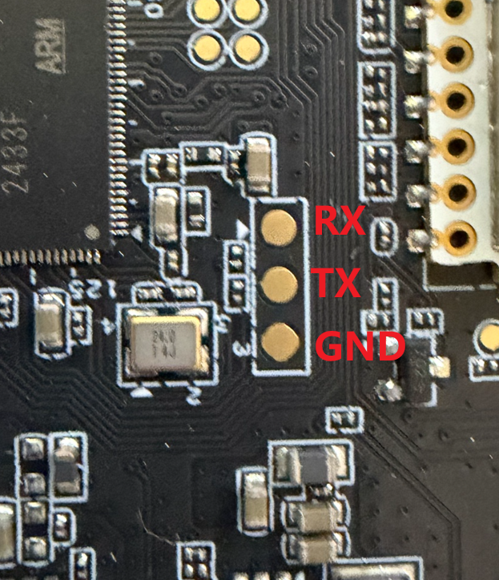

## 故障恢复
无法启动一般是由于错误的post_init.sh文件导致的，具体故障现象是：
1. 指示灯常亮不闪烁
2. 无法恢复出厂设置
3. 不联网

## 解决办法
### 所需工具
  * USB转TTL工具，如CH340、343等
  * 焊锡焊接工具
### 操作步骤
1. 拧下网关底部防滑垫盖住的2颗螺丝，沿边缘撬开底壳
2. 将USB转TTL工具的TX/RX/GND分别连接到主板这个3个测试点，注意TX与RX需要对调
    
3. 将USB转TTL工具连接到PC,使用串口工具如putty，波特率115200，打开串口，然后给网关通电
4. 网关会输出启动日志，等待一会，会提示`login`,输入`root`后回车，密码默认为空，也直接回车，如果你之前设置过密码，则输入你的密码
5. 执行删除命令，删除错误的post_init.sh文件：
    ```sh
    rm /data/scripts/post_init.sh
    ```
6. 输入`reboot`重启，等待网关telnet重新上线即可